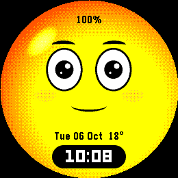
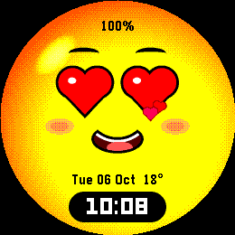
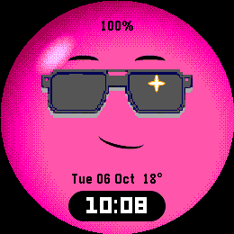
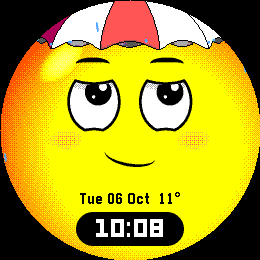

# Orbi

An expressive orb face for the **Pebble Round 2 (gabbro)**, after Orbi, the
emoji that lives on the Las Vegas Sphere. He's a glossy little sphere who
looks around, laughs, sneezes, falls in love, puts shades on when it's sunny,
holds an umbrella when it rains, and wears a nightcap at bedtime.



<p>
  
  
  
</p>

## What he does

- **Shows**: every couple of minutes (Lively), he puts one on: laughing with
  `^ ^` eyes and tears of joy, a cheeky wink with his tongue out, heart eyes,
  a sneeze (ah... ah... CHOO), dizzy spinning eyes with stars, grumpy with a
  red face and steam, crying, yawning, whistling, hiccups, an eye roll,
  suspicious side-eye, going cross-eyed, and "deal with it" shades.
- **Weather**, from your phone's location: a cloud rains on him until he gets
  his umbrella out, a beanie and tongue out for snowflakes, chattering teeth
  in the cold, panting then shades in the heat, scared stiff by thunder and
  lightning, squinting into fog, leaves blowing past in the wind. Between
  shows, rain and snow keep falling and his resting face matches the weather.
- **Seasons**: a witch hat and an evil cackle in the last days of October, a
  Santa hat and "ho ho ho" in December.
- **On the hour**: a party hat and confetti.
- **Poke him**: flick your wrist or tap the screen. Tap his eyes and he
  flinches; tap lower and it tickles. Do it twice quickly and he gets dizzy.
- **Events**: a zap and a happy sigh when you put him on charge, a worried
  look around when the phone disconnects, tired and sweating when the battery
  is low.
- **Quiet hours** (optional): he yawns, puts his nightcap on and sleeps, with
  Zzz. A flick wakes him, groggy, for a moment.

He also shows the time in a black pill, the date with the temperature, and
the battery percentage.

## Settings

| Setting | Default | Notes |
|---|---|---|
| Clock format | Match watch | 12 / 24 hour |
| Leading zero | On | |
| Clock style | White on a black pill | Plain black, or hidden |
| Date | `Tue 06 Oct` | Six formats, or hidden |
| Temperature after the date | On | Needs weather on |
| Battery percentage | Always | Hidden, or only when low (30% or less) or charging |
| Liveliness | Lively | Still / Calm (only when poked) / Lively / Always moving |
| Minutes between shows | 2 | 1–15, for Lively |
| Go still at battery | 20% | Never / 10 / 20 / 30 / 50% |
| Quiet hours | Off, 11 pm – 7 am | Sleeps in a nightcap |
| React to a wrist flick | On | |
| React to a tap | On | |
| Say hello on wrist raise | Off | Reads the accelerometer constantly |
| Colour | Classic yellow | Tangerine, Bubblegum, Mint, Sky |
| Hats, shades and umbrellas | On | Off: the same shows, without props |
| Seasonal hats | On | |
| Party on the hour | On | |
| Worry when the phone disconnects | On | Vibrates too |
| React to the weather | On | Open-Meteo, every 30 minutes |
| Fahrenheit | Off | |

Uses `@rebble/clay`, not `pebble-clay`, which refuses to build for gabbro.

## Battery

Frames only run while something is moving. When a show ends he glances
around for 8 seconds, settles, and the frame timer stops: the last frame stays
on screen and costs nothing but the minute tick. Between shows a single blink
or glance wakes the loop for a fraction of a second every 6–16 seconds.
Weather particles freeze mid-air when he's still rather than keeping frames
running. A frame takes about 4 ms to draw in the emulator, at 30 fps.

- **Still** never animates. **Calm** only puts on a show when you poke him,
  plus the odd blink. **Lively** adds a show every few minutes. **Always
  moving** never stops (v1 behaved like this, and it drains the battery).
- The battery saver (20% by default) switches to Still with a tired face until
  the watch is charging.

## How it works

Everything on the face is drawn by code straight into the framebuffer, except
the props, which are pixel art from PixelLab.

**`raster.c`**: a small coverage rasteriser. Every shape is the intersection
of up to five convex constraints: inside an ellipse (which can be rotated),
outside an ellipse, or one side of a line. That covers eyes clipped by curved
lids, crescent smiles, a mouth with teeth and a tongue, hearts, bolts and
notes. Rows are sampled at four sub-rows with exact horizontal coverage, so
edges are antialiased into the 64-colour palette, and coordinates are Q4
(1/16 px) so slow movement doesn't step. A rotated ellipse's row span comes
out in closed form: centre `y·cs(rx²−ry²)/A`, half-width `rx·ry·√(A−y²)/A`
with `A = ry²c² + rx²s²`, so it costs one integer square root per row. There
is no FPU, so all per-pixel and per-row work is integer.

**`bg.c`**: the orb, lit from the top left: a rim shadow measured from a point
below and right of centre, a gloss spot along the top-left edge, ordered
dither between neighbouring colours of a five-step ramp per theme. It's
computed once per theme into a cache of only the non-flat pixels (about
25 KB); a frame is then a memset and two short copies per row.

**`face.c`**: turns a pose into shapes. Features sit on a virtual sphere a
little bigger than the screen, so turning the head slides them across it and
foreshortens the far side, which is what makes him read as a ball rather than
a flat face. Eyelids are big circles: the top one tilts (angry, sad), the
bottom one tightens into a curve for smiling eyes, and a closed eye becomes a
`^`, flat or `‿` arc.

**`anim.c`**: every part of the pose is a damped spring, mostly
under-damped, so head turns settle, eyes pop and bounces wobble. Expressions
are tables of spring targets. Shows ("acts") are timed key lists: set an
expression, look somewhere, blink or wink, kick a spring, shake, swap a prop,
emit particles, start rain, run an oscillator. Between acts, idle life
glances around, with the head following the eyes, and blinks. Particles
(rain, snow, hearts, confetti, tears, steam, notes, leaves, Zzz, lightning)
have simple per-kind physics, and rain splashes off the umbrella.

**`main.c`**: the frame loop and battery policy, settings, weather, quiet
hours, battery and Bluetooth events, flick, tap and optional wrist raise.
Prop bitmaps load when they appear and are freed when they go.

**Props**: generated with PixelLab, forced to the watch's 64 colours
(`art/pebble64.png`), raw output in `art/raw/`. `tools/make_props.py` crops
them, flips the nightcap, scales the sunglasses 1.5x (nearest neighbour), cuts
each to 15 colours so it stays a 4-bit bitmap, and writes
`resources/images/`.

**Weather**: `src/pkjs/index.js` gets the phone's location and asks
[Open-Meteo](https://open-meteo.com) (no API key) for the current weather
code, temperature, day/night and wind. It sends a condition code (see
`WeatherKind` in `anim.h`) on start-up and whenever the watch asks, which it
does every 30 minutes. The watch keeps the last report and ignores it after
three hours.

## Build and test

```bash
pebble build                                  # build/orbi-face.pbw
pebble install --emulator gabbro
python3 tools/shot.py gabbro out.png          # screenshot via the QEMU monitor
pebble emu-tap --emulator gabbro              # flick
```

**On the Mac, without the emulator.** `tools/host/` compiles the portable
code (`raster`, `bg`, `face`, `anim`) against a stub `pebble.h` and renders
frames, props included, exactly as the watch would:

```bash
tools/host/run.sh /tmp/laugh 3 3.6 4          # act 3 (LAUGH) for 3.6s, every 4th frame
python3 tools/host/gallery.py /tmp/acts.png LAUGH:900 LOVE:1000 RAIN:3200 0:0:2=bubblegum
```

`act:ms[:theme[:weather[:temp]]]` picks one frame of an act; act names are
from `ActId` in `anim.h`. This is how every expression was tuned.

Verification-only build flags (see `wscript`; never ship a bundle built with
them):

| Flag | Effect |
|---|---|
| `ORBI_SHOW_TIME=1008` | Always shows 10:08 |
| `ORBI_FREEZE=<act> ORBI_FREEZE_MS=<ms>` | Holds an act at one moment |
| `ORBI_LOOP=<act>` | Replays one act forever |
| `ORBI_DEMO=1` | Replays the store GIF's run: laugh, cool, love |
| `ORBI_THEME=<n>` | Forces a colour theme |
| `ORBI_WEATHER=<kind> ORBI_TEMP=<c> ORBI_WIND=<kmh>` | Fakes the weather |
| `ORBI_BATT=<pct>` | Fakes the battery level |
| `ORBI_DEBUG=1` | Draws render time and whether frames are running |

The emulator can't inject touch and can't send SELECT/BACK reliably, and it
follows the host clock, hence the flags. Screendumps come back on a reduced
colour scale; `tools/shot.py` and `tools/record.py` snap them back to the real
palette.

## Store assets

`store/` holds the appstore set:

| File | Size | Used for |
|---|---|---|
| `gabbro_1_preview.gif` | 260x260 | One run of the demo (laugh, cool, love), real speed |
| `gabbro_2_time.png` | 260x260 | Resting face at 10:08 |
| `gabbro_3_love.png` | 260x260 | Heart eyes |
| `gabbro_4_bubblegum.png` | 260x260 | Bubblegum theme, shades on |
| `gabbro_5_rain.png` | 260x260 | Rain, under the umbrella |
| `icon_80x80.png` | 80x80 | `pebble publish` iconSmall |
| `icon_144x144.png` | 144x144 | `pebble publish` iconLarge |
| `banner_720x320.png` | 720x320 | Store header image |

To regenerate (needs the gabbro emulator to yourself, about five minutes):

```bash
python3 tools/record_store.py /tmp/orbi_rec     # builds each pinned variant and records it
python3 tools/store_assets.py /tmp/orbi_rec     # GIF, screenshots, icons, banner
```

`record_store.py` leaves a flag-free build behind, but check before
releasing.

To publish (not done yet), from a clean release build, after bumping
`version` in `package.json` past whatever the store holds:

```bash
pebble publish --non-interactive \
  --description "A little orb with big feelings: weather, hats and faces" \
  --icon-small store/icon_80x80.png --icon-large store/icon_144x144.png \
  --screenshots store/gabbro_*.{gif,png}
```

## Target platform

The layout is drawn for the 260x260 round screen, so `targetPlatforms` is
`gabbro` only. The renderer itself is size-independent; another platform needs
new feature positions in `face.c` and new prop sizes.
