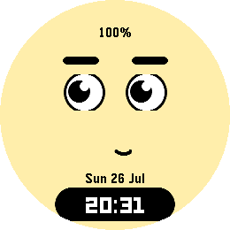

# orbi-face

An animated, expressive face watchface for the Pebble Round 2 (**gabbro**),
written in C using the Pebble SDK. Inspired by the "Sphere"-style expressive
robot faces, it blinks, winks, and idly glances around between showing the
time, date, and battery level.

<p align="center">
  
</p>

## Features

- A full library of expressions (blink, wink, angry, surprised, side-eye,
  sleepy, happy, look-up, smirk) that ease smoothly between poses at ~30fps
  rather than snapping.
- Idle behaviour: the face wanders its gaze and blinks naturally on its own,
  and cycles through its expressions once on startup.
- A random expression plays out once a minute, tied to the clock tick.
- **Battery saver**: below 20% charge (and not charging/plugged in), the
  animation loop freezes on a still neutral face to save power, resuming
  automatically once charged back up.

## Building & running

```sh
pebble build
pebble install --emulator gabbro
pebble install --phone <ip>
```

## Note on target platform

The layout is hardcoded to the 260x260 circular gabbro display (`SCREEN_W`/
`SCREEN_H`/`CX`/`CY` in `src/c/orbi_face.c`), so `targetPlatforms` in
`package.json` is deliberately restricted to `gabbro` only — it will not
look right on other screen sizes without reworking the geometry to be
resolution-independent.

## Project layout

```
src/c/           C source for the watchface
screenshots/     Emulator screenshots used in this README
package.json     Project metadata (UUID, platforms, resources, message keys)
wscript          Build rules — usually no need to edit
```

## Documentation

Full SDK docs, tutorials, and API reference: <https://developer.repebble.com>
